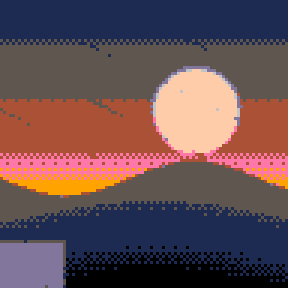
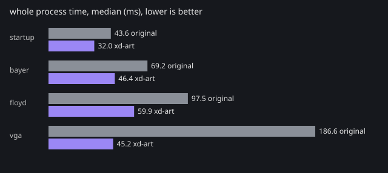

# xd-art

xd-art turns images into pixel art: it makes them small, maps them to a palette and
dithers them. It comes as a desktop app, a command line tool, a Rust library and a
page that runs in the browser.



[Leia em português](README.pt-BR.md)

## Where it comes from

xd-art started as a Rust port of
[SLK_img2pixel](https://github.com/Captain4LK/SoftLK-tools/tree/master/SLK_img2pixel)
by Lukas Holzbeierlein ([Captain4LK](https://github.com/Captain4LK)), which is public
domain (CC0). Its algorithms were rewritten in Rust and checked against the original's
own code: most options give exactly the same pixels, the smooth resamplers and color
adjustments stay within one step out of 255, and the few deliberate differences are
listed in [docs/compat.md](docs/compat.md). The interface, written with
[GPUI](https://gpui.rs), and many features are new. [docs/credits.md](docs/credits.md)
lists what was ported and what was added.

## Install

Releases for Windows, Linux and macOS are built by a workflow when a version is
tagged; none has been published yet. Until then, build from source with Rust
(the version is pinned in `rust-toolchain.toml`):

```sh
cargo build --release
```

This gives `target/release/xd-art` (the app) and `target/release/xd-art-cli`. On
Linux the app needs a few system libraries; [docs/building.md](docs/building.md) has
the list and the release download steps.

## The app

```sh
xd-art photo.jpg
```

Open or drop an image and it is converted right away with the last settings. The
settings are on the left in the order they are applied, the result fills the middle,
the palette sits under it. Some of what is there:

- live preview that stays responsive on big images, before/after divider, pixel grid,
  zoom on the pointer;
- a gallery of every dither mode on your image, history with undo, up to four
  variations side by side;
- palette editing with locked colors, a pencil and eraser that only use palette colors,
  and a brush for where dithering applies;
- a GIF frame editor, export to PNG, GIF, sprite sheets, block game textures and files
  for pixel art editors;
- four dark themes, English and Portuguese, a command palette (Ctrl+K).

[docs/gui.md](docs/gui.md) describes all of it, with every shortcut.

## The command line

```sh
xd-art-cli convert photo.jpg -o pixel.png -w 96 --palette pico-8 --dither floyd
xd-art-cli batch photos/ -o pixel/ --preset game-boy
xd-art-cli list palettes
```

Every option of the engine is a flag; recipes (small JSON files with all the settings)
work in both directions; batch mode converts folders on all cores; `--json` gives one
line per file for other programs; Lua scripts can drive it. See
[docs/cli.md](docs/cli.md), [docs/recipes.md](docs/recipes.md) and
[docs/scripting.md](docs/scripting.md).

## Measured

On Windows 11 with an AMD Ryzen 9 7950X, release builds. How each number was taken is
in [docs/performance.md](docs/performance.md).

Against the original command line tool, same images, same preset, whole process,
median of 10 runs (the outputs of the two middle cases are identical pixel for pixel):

| case | SLK_img2pix_cmd | xd-art-cli |
|---|---|---|
| 16x16 to 64x64, bayer 4x4 | 43.6 ms | 32.0 ms |
| 1920x1080 to 160x90, bayer 4x4 | 69.2 ms | 46.4 ms |
| 1920x1080 to 320x180, Floyd-Steinberg | 97.5 ms | 59.9 ms |
| 640x480 to 640x480, Floyd-Steinberg | 186.6 ms | 45.2 ms |



The app, median of 15 starts:

| | time from the start of `main` |
|---|---|
| first frame of the empty window | 260 ms (about 238 ms of it inside gpui's own setup) |
| a 200x120 image converted and on screen | 265 ms |
| a second launch handing its file to a resident window (`--resident`) | 37 ms for the whole process |

The startup of the original's interface was not compared: it needs SDL3, which was not
available on the test machine.

## Repository

```text
crates/
  xd-art-core    the engine (sampling, palettes, dithering, I/O, recipes, exporters)
  xd-art-gui     the desktop app
  xd-art-cli     the command line tool
  xd-art-lua     Lua scripting for the command line tool
  xd-art-wasm    the engine for the browser
  xd-art-text    interface text in English and Portuguese
  xd-art-bench   benchmarks, speed check, test images
web/             the browser page (docs/web.md)
docs/            guides, decisions, measurements
examples/        recipes and Lua scripts
integration/     launcher and right click menu files (docs/integration.md)
gallery/         results with the recipes that made them
scripts/         goldens, measurements, doc pictures, comparison with the original
```

Start with [docs/architecture.md](docs/architecture.md) to find your way around, and
[docs/algorithms.md](docs/algorithms.md) for what each option does, with pictures.
Contributions are welcome: [CONTRIBUTING.md](CONTRIBUTING.md).

## License

MIT, see [LICENSE](LICENSE). The original SLK_img2pixel is CC0; palettes and other
third party material are listed with their licenses in
[docs/credits.md](docs/credits.md).

[github/joaopssx](https://github.com/joaopssx)
