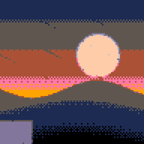
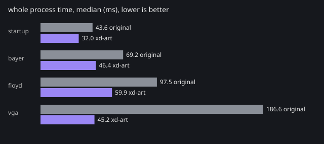

# xd-art

O xd-art transforma imagens em pixel art: reduz o tamanho, passa as cores para uma
paleta e aplica dithering. Ele vem como aplicativo de desktop, ferramenta de linha de
comando, biblioteca em Rust e uma página que roda no navegador.



[Read in English](README.md)

## De onde ele veio

O xd-art começou como uma portagem para Rust do
[SLK_img2pixel](https://github.com/Captain4LK/SoftLK-tools/tree/master/SLK_img2pixel),
de Lukas Holzbeierlein ([Captain4LK](https://github.com/Captain4LK)), que é domínio
público (CC0). Os algoritmos foram reescritos em Rust e conferidos contra o próprio
código do original: a maioria das opções dá exatamente os mesmos pixels, os
redimensionamentos suaves e os ajustes de cor ficam a no máximo um passo de 255, e as
poucas diferenças de propósito estão listadas no [docs/compat.md](docs/compat.md). A interface, feita com [GPUI](https://gpui.rs), e
muitos recursos são novos. O [docs/credits.md](docs/credits.md) lista o que foi portado
e o que foi acrescentado.

## Instalação

As versões para Windows, Linux e macOS são montadas por um workflow quando uma versão
recebe uma tag; nenhuma foi publicada ainda. Até lá, compile a partir do código com Rust
(a versão está fixada em `rust-toolchain.toml`):

```sh
cargo build --release
```

Isso gera `target/release/xd-art` (o aplicativo) e `target/release/xd-art-cli`. No
Linux o aplicativo precisa de algumas bibliotecas do sistema; o
[docs/building.md](docs/building.md) tem a lista e os passos para baixar as versões
prontas.

## O aplicativo

```sh
xd-art foto.jpg
```

Abra ou solte uma imagem e ela é convertida na hora, com as últimas configurações
usadas. As configurações ficam à esquerda, na ordem em que são aplicadas, o resultado
ocupa o meio e a paleta fica embaixo dele. Um pouco do que tem lá:

- prévia ao vivo que continua rápida em imagens grandes, divisor de antes e depois,
  grade de pixels, zoom no ponteiro;
- uma galeria com todos os modos de dithering na sua imagem, histórico com desfazer,
  até quatro variações lado a lado;
- edição da paleta com cores travadas, lápis e borracha que só usam cores da paleta, e
  um pincel para marcar onde o dithering vale;
- editor de quadros de GIF, exportação para PNG, GIF, sprite sheets, texturas de jogos
  de blocos e arquivos para editores de pixel art;
- quatro temas escuros, inglês e português, paleta de comandos (Ctrl+K).

O [docs/gui.md](docs/gui.md) descreve tudo, com todos os atalhos (em inglês).

## A linha de comando

```sh
xd-art-cli convert foto.jpg -o pixel.png -w 96 --palette pico-8 --dither floyd
xd-art-cli batch fotos/ -o pixel/ --preset game-boy
xd-art-cli list palettes
```

Toda opção do motor vira uma flag; receitas (pequenos arquivos JSON com todas as
configurações) funcionam nos dois sentidos; o modo em lote converte pastas usando todos
os núcleos; `--json` gera uma linha por arquivo para outros programas lerem; scripts em
Lua podem comandar tudo. A ajuda e as mensagens saem em português quando o sistema
está em português (ou com `XD_ART_LANG=pt`). Veja [docs/cli.md](docs/cli.md),
[docs/recipes.md](docs/recipes.md) e [docs/scripting.md](docs/scripting.md).

## Medições

No Windows 11 com um AMD Ryzen 9 7950X, versões release. Como cada número foi medido
está em [docs/performance.md](docs/performance.md).

Contra a ferramenta de linha de comando original, mesmas imagens, mesmo preset, processo
inteiro, mediana de 10 execuções (as saídas dos dois casos do meio são idênticas pixel
a pixel):

| caso | SLK_img2pix_cmd | xd-art-cli |
|---|---|---|
| 16x16 para 64x64, bayer 4x4 | 43,6 ms | 32,0 ms |
| 1920x1080 para 160x90, bayer 4x4 | 69,2 ms | 46,4 ms |
| 1920x1080 para 320x180, Floyd-Steinberg | 97,5 ms | 59,9 ms |
| 640x480 para 640x480, Floyd-Steinberg | 186,6 ms | 45,2 ms |



O aplicativo, mediana de 15 aberturas:

| | tempo desde o início do `main` |
|---|---|
| primeiro quadro da janela vazia | 260 ms (cerca de 238 ms disso dentro da preparação do próprio gpui) |
| uma imagem de 200x120 convertida e na tela | 265 ms |
| uma segunda abertura entregando o arquivo para uma janela residente (`--resident`) | 37 ms o processo inteiro |

A abertura da interface do original não foi comparada: ela precisa do SDL3, que não
estava disponível na máquina de teste.

## O repositório

```text
crates/
  xd-art-core    o motor (amostragem, paletas, dithering, E/S, receitas, exportação)
  xd-art-gui     o aplicativo de desktop
  xd-art-cli     a ferramenta de linha de comando
  xd-art-lua     scripts em Lua para a linha de comando
  xd-art-wasm    o motor para o navegador
  xd-art-text    os textos da interface em inglês e português
  xd-art-bench   benchmarks, checagem de velocidade, imagens de teste
web/             a página do navegador (docs/web.md)
docs/            guias, decisões, medições
examples/        receitas e scripts em Lua
integration/     arquivos de atalho e de menu do botão direito (docs/integration.md)
gallery/         resultados com as receitas que os geraram
scripts/         goldens, medições, imagens da documentação, comparação com o original
```

Para se achar no código, comece pelo [docs/architecture.md](docs/architecture.md); para
entender cada opção, com imagens, veja o [docs/algorithms.md](docs/algorithms.md). Os
documentos estão em inglês. Contribuições são bem-vindas:
[CONTRIBUTING.md](CONTRIBUTING.md).

## Licença

MIT, veja [LICENSE](LICENSE). O SLK_img2pixel original é CC0; paletas e outros
materiais de terceiros estão listados com suas licenças no
[docs/credits.md](docs/credits.md).

[github/joaopssx](https://github.com/joaopssx)
