# How the conversion works

A short tour of what happens to an image, in the order xd-art does it, with a picture
for most choices. Every picture on this page is the same 256x256 synthetic landscape
(`xd_art_bench::scene`) converted by `xd-art-cli`; `scripts/gen-doc-images.sh` makes
all of them again and prints the options used for each.

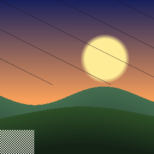

The landscape has a sky gradient (hard for few colors), a sun with a soft edge, two
hills, thin one pixel lines like wires, and a checker of 2x2 squares in the corner (the
classic way to fool a resize).

## 1. Blur

An optional blur on the full size image, before anything gets smaller. It removes
detail that would otherwise turn into noise: grain in photos, JPEG blocks, the wires.

| radius 0 | radius 2 | radius 6 |
|---|---|---|
|  | 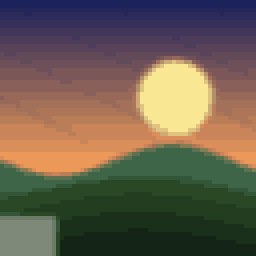 | 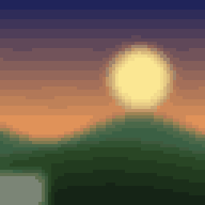 |

The blur is a Gaussian computed in two passes (rows, then columns). For large radii
xd-art switches to three box blurs in a row, which look almost the same and cost the
same at any radius. "Original blur" uses the exact box blur of SLK_img2pixel instead.

## 2. Sampling

Making the image small: every output pixel has to get one color from the many source
pixels it covers. All pictures here are 64x64 with 32 colors taken from the image and
no dithering, shown four times larger.

| nearest | bilinear | lanczos |
|---|---|---|
| 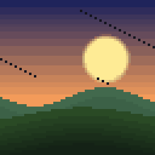 |  | 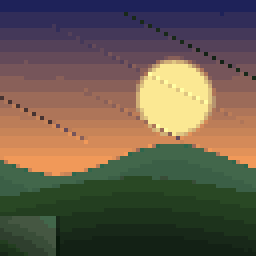 |

| box | cluster | edge |
|---|---|---|
| 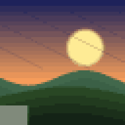 | 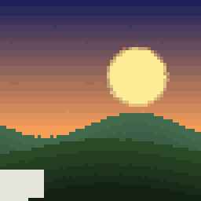 | 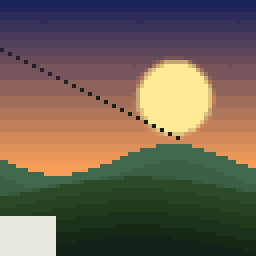 |

- **Nearest** takes the one source pixel closest to the center. Sharp and fast, but it
  picks whatever happens to be there: the wires turn into broken dots and the checker
  becomes one flat color, because every sample lands on the same kind of square.
- **Bilinear** blends the 4 nearest pixels, **bicubic** 16 and **Lanczos** 36. Softer,
  with thin lines fading out. Lanczos keeps the most contrast of the three.
- **Box** averages everything the output pixel covers. The checker becomes the gray it
  looks like from far away; the wires mostly disappear.
- **Cluster** takes the most common color of the area. Flat regions stay flat and
  clean, small details vanish (here the checker comes out as one light color and the
  wires are gone).
- **Edge** averages the area but leans toward pixels that look like its center, so
  edges stay hard. It keeps the wires and gives the hills a crisp outline. It is new in
  xd-art, not a port.

## 3. Color adjustments

Sharpen, brightness, contrast, saturation, hue, gamma and tint run on the small image,
after sampling, the same order as the original program. They are simple per pixel
formulas; on a 64x64 image they cost almost nothing.

## 4. Palette

The palette is the set of colors the result may use: a built-in one (PICO-8, Game Boy,
and others listed in `docs/credits.md`), a file, or colors taken from the image.

Taking colors from the image ("extract"), 8 colors here:

| k-means | median cut | balanced |
|---|---|---|
| 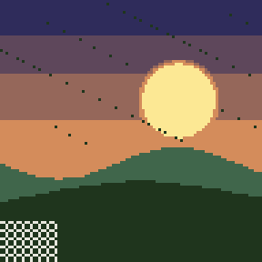 | 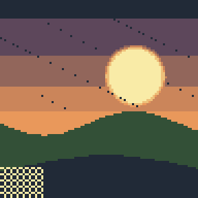 | 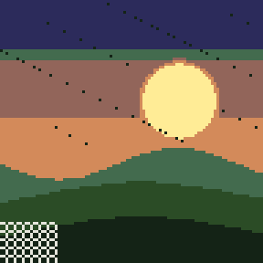 |

- **K-means** starts with a guess and moves each color to the middle of the pixels
  closest to it, again and again. Good overall colors; small areas can lose out.
- **Median cut** splits the colors of the image in half along their widest spread,
  again and again, and takes the average of each part. Fast and predictable.
- **Balanced** gives small but distinct areas (the sun, the checker) a better chance
  to keep their own color.

Colors can be locked so extraction always keeps them.

## 5. Color distance

To map a pixel, xd-art picks the palette color that is "closest". What closest means
matters most with few colors. Same 4 color Game Boy palette, three ways to measure:

| RGB | redmean | CIEDE2000 |
|---|---|---|
| 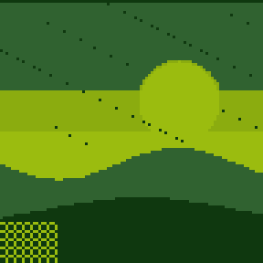 | 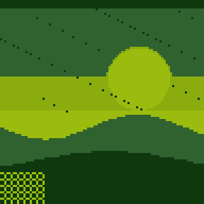 | 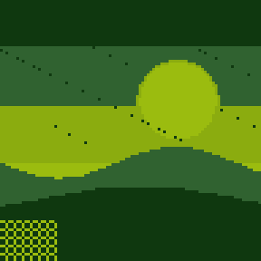 |

- **RGB** is the straight distance between the red, green and blue values. Simple, but
  the eye does not see those three equally.
- **Weighted RGB** and **redmean** correct for that with cheap formulas. Redmean is the
  default and the one the live preview uses while a slider moves.
- **CIE76, CIE94, CIEDE2000** convert to Lab, a color space built to match human
  perception, and measure there. CIEDE2000 is the most careful and several times slower
  per pixel. The status bar shows when the preview used a cheap metric in place of an
  expensive one.

xd-art remembers the answer for colors it has already seen and, for big palettes,
searches a k-d tree instead of trying every color; both give exactly the same answer as
trying every color.

## 6. Dithering

With few colors, smooth gradients turn into bands. Dithering trades the bands for a
pattern or a grain that the eye blends back into in-between colors. 96x96 to PICO-8,
amount 0.4, shown three times larger.

| none | bayer 2x2 | bayer 4x4 |
|---|---|---|
| 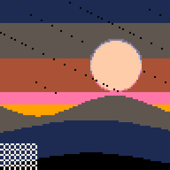 |  | 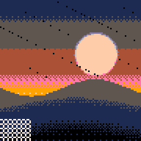 |

| bayer 8x8 | cluster 8x8 | picocad |
|---|---|---|
| 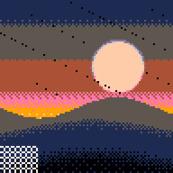 | 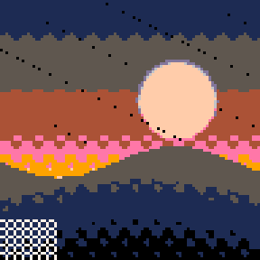 | 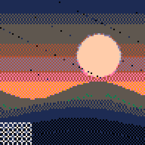 |

| Floyd-Steinberg | Floyd-Steinberg mono | Stucki |
|---|---|---|
| 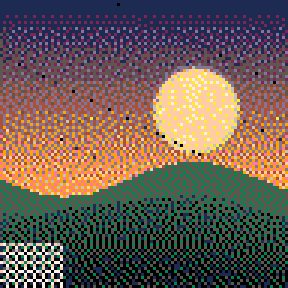 | 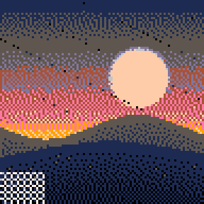 | 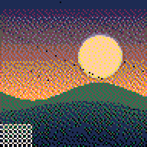 |

| Sierra lite | median cut |  |
|---|---|---|
| 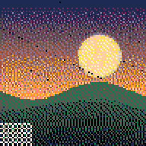 | 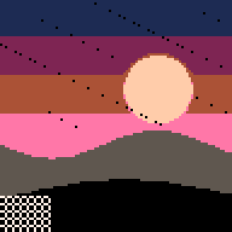 |  |

**Ordered dithering** (Bayer, cluster, picocad) nudges each pixel up or down by a fixed
amount from a small tiled table before picking its color. The pattern is regular, it
does not crawl when the image changes a little (good for animation), and every pixel
can be computed on its own, so it splits across threads perfectly.

- **Bayer** tables spread the nudges as evenly as possible: the familiar cross-hatch.
  Bigger tables give more in-between shades.
- **Cluster** tables grow dots from the middle of each tile, like newspaper print.
- **Picocad** only dithers between the two closest colors and only where a pixel sits
  between them, the way the picoCAD modeling program draws its shading.

**Error diffusion** (Floyd-Steinberg, Stucki, Burkes, Sierra and its lighter variants)
picks the closest color for a pixel, then pushes the difference ("error") onto the
neighbors that come after it. The result follows the image more closely and looks like
film grain rather than a pattern, but it depends on every pixel before it, so it changes
all over when one setting moves. The kernels differ in how far the error spreads:
Floyd-Steinberg to 4 neighbors, Stucki to 12 (softer), Sierra lite to 3 (crisper).
"Mono" averages the error over the three channels, which avoids colored specks.

xd-art runs error diffusion on several threads as a wavefront: each row starts once the
row above is far enough ahead, so every pixel gets exactly the error it would get on one
thread.

**Median cut** as a dither mode is not a pattern at all: it splits the image into
regions and gives each one a single palette color. Flat, poster-like areas.

The **amount** scales the nudge or the error. A **mask** (painted in the app or given as
a grayscale image) sets the amount per area: black for no dithering, white for full.

## 7. Clean up and output

After mapping, optional steps work on the palette indices: an outline or inline in a
chosen color, removing single stray pixels, merging colors that ended up almost the
same. Then the result is scaled up by a whole number (each pixel becomes a k x k block)
and written. Scanlines and a CRT curve are export effects only; they never change the
pixel art itself.

Where any of this differs from SLK_img2pixel, `docs/compat.md` says so.
