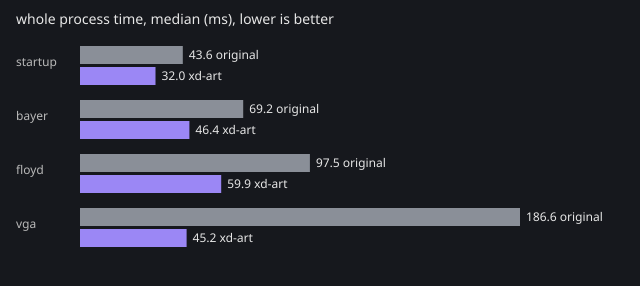

# Performance

Numbers here are measured, with the command next to them. Unless a section says
otherwise, the machine is Windows 11 Pro, AMD Ryzen 9 7950X (16 cores, 32 threads),
32 GB RAM, rustc 1.95.0, release profile from the workspace `Cargo.toml`.

Criterion reports a range; the tables show its middle value.

## Sampling

```sh
cargo bench -p xd-art-bench --bench resize -- --warm-up-time 1 --measurement-time 2 sample
```

Input is a synthetic 1920x1080 image (`xd_art_bench::photo_like`).

| mode | 160x90, first port | 160x90, now | 960x540, first port | 960x540, now |
|---|---|---|---|---|
| nearest | 29.2 µs | 29.7 µs | | |
| bilinear | 162 µs | 145 µs | 5.76 ms | 0.78 ms |
| bicubic | 1.04 ms | 0.25 ms | | |
| lanczos | 1.92 ms | 0.19 ms | 68.0 ms | 1.66 ms |
| box | 1.10 ms | 0.20 ms | | |
| cluster | 69.3 ms | 4.86 ms | | |

"First port" is the straight translation of the original's loops, one thread. "Now" is
the same math with three changes:

- Rows run in parallel with rayon, in groups sized by how much work a pixel is (a
  Lanczos sample reads 36 source pixels, a nearest sample one), so a 160x90 nearest
  resize stays on one thread and a 160x90 cluster resize uses all of them.
- Values that only depend on the column (source position, fraction, the six Lanczos
  weights with their `sin` calls) are computed once per image instead of once per
  pixel. That alone is most of the Lanczos gain.
- The four channels go through the filters as `[f32; 4]`, with the same operations in
  the same order as the scalar code. LLVM turns those into SSE instructions. Each
  channel still sees the exact sequence of `f32` roundings it had before, so the golden
  tests did not move.

There is no hand written SIMD and no `unsafe` in the sampling code. I tried to find a
place where intrinsics would pay off and the remaining time is in memory access (the
source of a 1920x1080 image in the working format is 16 MB), not arithmetic.

### fast_image_resize

```sh
cargo run --release -p xd-art-bench --example fir_diff
```

| filter | max diff 160x90 | channels off by more than 1 | max diff 960x540 | channels off by more than 1 |
|---|---|---|---|---|
| bilinear | 16 | 82.4% | 20 | 75.7% |
| bicubic | 20 | 85.9% | 23 | 80.8% |
| lanczos | 28 | 87.2% | 26 | 83.4% |
| box | 1 | 0.0% | 1 | 0.0% |

Time for the same 160x90 reduction (same bench command): bilinear 247 µs, bicubic
452 µs, lanczos 864 µs, box 134 µs.

The difference is expected: `fast_image_resize` does proper convolution (every source
pixel under the filter contributes, weights normalized, edges clamped). The original
samples the filter at one point per output pixel, with `(size - 1) / size` steps and
black outside the image. Those are two different results, not two speeds of the same
result. See the decision in [decisions.md](decisions.md).

## Blur

```sh
cargo bench -p xd-art-bench --bench blur -- --warm-up-time 1 --measurement-time 3
```

1920x1080 synthetic image, all cores.

| radius | exact gaussian | running box (3 passes) | original box (compatible) |
|---|---|---|---|
| 2 | 6.92 ms | 11.3 ms | 11.5 ms |
| 8 | 18.9 ms | 11.8 ms | 11.0 ms |
| 32 | 66.3 ms | 11.6 ms | 10.9 ms |

The gaussian grows with the kernel; both box versions do not. They cross between radius
4 and 5, so the default `box_from` is 5: from there on the gaussian mode uses the running
box passes.

Accuracy of that switch, from the test `large_radius_approximation_is_close` on a
160x120 noise image (noise is the worst case): the running box result is identical to
the exact gaussian in 8-bit terms away from the edges, and at most 1 step off within
`3 sigma` of an edge, at radius 8 and 20. The first version clamped at the end of each
of the three passes and was up to 21 steps off in the corners; extending the line once
with its end pixels before the passes fixed that.

## Closest color lookups

```sh
cargo run --release -p xd-art-bench --example lut_error
```

The 3D table (32 cells per channel, up to 8 candidate colors per cell, exact distance
among the candidates) against the exact linear search, over all 16,777,216 RGB colors:

| palette | metric | table build | colors that differ | worst extra distance |
|---|---|---|---|---|
| pico-8 | redmean | 10.9 ms | 788 (0.0047%) | 0.019 |
| pico-8 | rgb | 11.1 ms | 447 (0.0027%) | 0.0065 |
| console-32 | redmean | 20.4 ms | 624 (0.0037%) | 0.016 |
| web-216 | redmean | 134 ms | 0 | 0 |
| pico-8 | cie76 | 21.2 ms | 574 (0.0034%) | 90.9 |

"Extra distance" is how much farther the color picked by the table is than the right
one, in the metric's own units (RGB metrics on `0..1` channels, squared). For CIE76 the
unit is squared LAB distance, so 90.9 is about 9.5 delta E: the table cells are cubes in
RGB, which are not where LAB metrics draw their borders. That is fine for the preview
while dragging, which uses a cheap RGB metric anyway, and never used for export.

Per lookup, one thread, web-216 with redmean on a 1024x1024 synthetic photo:

| method | time per pixel |
|---|---|
| exact linear search | 594 ns |
| exact search behind the 4096 slot cache (25% hits on this noisy image) | 361 ns |
| table | 5.9 ns |

The cache helps in proportion to how often colors repeat. On a noisy photo that is one
lookup in four; on an image that was already reduced and smoothed it is most of them.

### kd-tree threshold

```sh
cargo bench -p xd-art-bench --bench palette -- --warm-up-time 1 --measurement-time 2
```

Time for 4096 exact lookups against random palettes, in µs, one thread:

| colors | 16 | 24 | 32 | 48 | 64 | 128 | 256 |
|---|---|---|---|---|---|---|---|
| redmean, linear | 206 | 348 | 404 | 642 | 795 | 1595 | 3137 |
| redmean, kd-tree | 384 | 476 | 527 | 639 | 678 | 838 | 1042 |
| rgb, linear | 180 | 286 | 345 | 515 | 702 | 1636 | 3206 |
| rgb, kd-tree | 353 | 418 | 501 | 556 | 574 | 703 | 825 |

The two meet around 48 colors, so the tree is built from 64 colors up (`KD_FROM`). It
only exists for RGB, weighted, redmean and CIE76, the metrics with a per channel lower
bound; CIE94 and CIEDE2000 always search linearly. The tree gives exactly the linear
search's answer, ties included, which a test checks on 5000 colors for several palette
sizes.

## Dithering

```sh
cargo bench -p xd-art-bench --bench dither -- --warm-up-time 1 --measurement-time 3
```

640x480 synthetic image mapped to PICO-8 with redmean.

| mode | 1 thread | 32 threads |
|---|---|---|
| none (closest color) | 35.2 ms | 2.38 ms |
| bayer 4x4 | 36.4 ms | 2.44 ms |
| Floyd-Steinberg | 45.0 ms | 5.87 ms |
| Stucki | 54.3 ms | 6.78 ms |

Ordered modes split rows across threads. Error diffusion runs as a wavefront: each row
trails the one above by twice the kernel's reach, which keeps the order in which every
pixel receives its error the same as in the one thread loop. The result is identical
(a test compares 1, 3 and 8 threads for every mode on a 320x240 image), and the speedup
is lower than for the ordered modes because rows wait on each other.

## Speed check

```sh
cargo run --release -p xd-art-bench --example speed_check
```

Five whole conversions, each on one thread with an empty pipeline cache, median of 7.
The CI workflow runs it on every push and compares the medians with
`crates/xd-art-bench/speed-budget.txt`. Medians on the development machine (three runs
gave the same values within 0.5 ms) and the budgets, about four times as much:

| case | source | median here | budget |
|---|---|---|---|
| nearest-160x90 | 1920x1080 | 4.2 ms | 17 ms |
| lanczos-960x540 | 1920x1080 | 80.0 ms | 320 ms |
| blur8-160x90 (blur radius 8, nearest) | 1920x1080 | 71.6 ms | 290 ms |
| bayer4-640x480 | 640x480 | 37.5 ms | 150 ms |
| floyd-640x480 | 640x480 | 46.0 ms | 185 ms |

The CI job does not fail the build when a case goes over: shared runners can be two or
three times slower than a desktop and vary between runs. A case over budget shows up as
a failed (but allowed) job, which is the cue to run the criterion benches locally. If
the runners turn out steady enough, removing `continue-on-error` makes it blocking.

## Against the original

```sh
scripts/compare-original.sh [SoftLK-tools checkout] [runs]
```

The script builds the original's command line tool (`SLK_img2pix_cmd`) from source,
without SDL: its three image functions from the GUI library are replaced by
`scripts/original-cmd-shim.c`, which does the same thing with the same stb libraries.
Both programs then convert the same synthetic images with the same JSON preset (the
original's defaults with the size and dither mode changed; xd-art reads it with
`--recipe`), using all cores. Each number is the median of 10 whole runs (start, load,
convert, save, exit) after one warm-up run.

Measured on the machine at the top of this page, original at SoftLK-tools commit
`783b808` built with MSYS2 gcc 16.1.0 `-O3 -fopenmp`, xd-art at commit `ecee106`
(release profile). Raw numbers: `docs/img/compare-original.txt`.

| case | original | xd-art |
|---|---|---|
| 16x16 to 64x64, bayer 4x4 (mostly process start) | 43.6 ms | 32.0 ms |
| 1920x1080 to 160x90, bayer 4x4 | 69.2 ms | 46.4 ms |
| 1920x1080 to 320x180, Floyd-Steinberg | 97.5 ms | 59.9 ms |
| 640x480 to 640x480, Floyd-Steinberg | 186.6 ms | 45.2 ms |



The outputs of the two middle cases were compared pixel by pixel and are identical
(0 of 14400 and 0 of 57600 pixels differ), so the times are for the same work. Most of
the gap in the last case is error diffusion with the 256 color default palette: the
original searches the palette for every pixel, xd-art caches the answers and runs the
rows as a wavefront.

Not compared: the startup of the two interfaces. The original's GUI needs SDL3, which
is not installed on this machine, so only the command line tools were measured.

## GPU path (evaluated, not built)

```sh
cd scripts/gpu-probe && cargo run --release
```

The probe runs the two stages that fit compute shaders best on wgpu 30.0.1 (Vulkan,
NVIDIA GeForce RTX 4060 Ti) at the sizes of the CPU benchmarks above. "Round trip" is
what xd-art would pay per call: upload, dispatch, copy back, map, read. "Dispatch only"
leaves the data on the GPU. Medians of 50 calls; four runs of the probe gave the same
values within 0.02 ms.

| | GPU round trip | GPU dispatch only | CPU, 32 threads |
|---|---|---|---|
| bilinear 1920x1080 to 960x540 | 1.25 ms | 0.07 ms | 0.78 ms |
| bayer 4x4, PICO-8, redmean, 640x480 | 0.48 ms | 0.08 ms | 2.44 ms |

Setting the GPU up costs far more than either stage: creating the instance and adapter
took 303 to 428 ms and the device 28 to 47 ms on warm runs (773 ms and 168 ms on the
first run after boot), plus 14 to 27 ms for the two shaders and buffers.

The decision is in `docs/decisions.md`: no GPU path for now.


`crates/xd-art-core/tests/alloc.rs` counts heap allocations with a replacement global
allocator. A pipeline that already converted one frame converts the next one of the same
size (96x64 to 48x32, Floyd-Steinberg) with 12 allocations, none of them for pixels:
one `Arc` per stage result, the palette, the color matcher and its cache. GIF
conversion keeps one pipeline per thread for exactly this reason.

## Startup

What `xd-art` does from launch to the first frame, in order:

1. Collects the command line arguments as paths. Nothing is opened yet.
2. Reads the config file (a few hundred bytes). In resident mode, tries to hand the
   paths to a running instance and exits if one takes them.
3. Starts gpui and creates the window (1280x800, centered).
4. Creates the root view with no image.
5. If a path was given (also the case when a file is dropped on the executable), starts
   decoding it on a background thread. The UI thread never waits for it.
6. Draws the first frame: the empty state, or "opening <file>".

Not done at startup, on purpose: scanning folders for recent files or user palettes,
building any palette, reading or writing anything else than the config file (added
later, one small read), checking for updates, any network access, creating a Lua state.
Each of those happens the first time it is needed, or never.

### Startup trace

`XD_ART_TRACE=1` prints a line per step to stderr; `XD_ART_TRACE=file.log` appends them
to a file. Ctrl+Shift+D shows the same times over the preview. Times count from the
start of `main`, so loading the executable is not in them.

`scripts/measure-startup.sh [runs] [image]` runs the release build that many times (one
extra warm-up run), each run quitting by itself after the first frame or after the image
is shown, and prints medians. Measured on the machine above with the release profile,
15 runs, warm file cache:

| step | empty window | with a 200x120 PNG |
|------|-------------:|-------------------:|
| config read | 0.09 ms | 0.09 ms |
| platform (gpui ready) | 238.73 ms | 237.73 ms |
| window created | 254.97 ms | 253.55 ms |
| first frame | 260.34 ms | 258.39 ms |
| image decoded | | 262.49 ms |
| converted image shown | | 264.76 ms |
| whole run, from outside | 318.43 ms | 319.56 ms |

The config file is read before gpui starts, because resident mode (below) has to know
whether to hand the paths over before creating anything. Almost all of the time is the
second row: `Application::new()` and gpui's platform setup before it calls back. What
xd-art does after that, up to the first frame, is about 22 ms, and opening and
converting a small image adds 4 to 6 ms more. The 60 ms between the first frame and the
end of "whole run" is the process closing its window and exiting, which a user never
waits for. Where the 238 ms inside gpui goes was not measured here.

### Resident instance

With `--resident` (or the "stay resident" setting, Ctrl+Shift+R), the first instance
listens on a local port and later launches hand their paths to it and exit before gpui
starts. Measured on the same machine with the release build:

| | time |
|---|---|
| later launch, inside the process, start of `main` to paths handed over | 1.5 ms (3 runs: 1.45, 1.52, 1.69) |
| later launch, whole process from bash, median of 15 | 37.2 ms (36.5 to 45.3) |
| normal launch to the image on screen, whole process, median of 15 | 319.56 ms |

Memory of the resident process, read from Windows (working set and private bytes):

| state | working set | private |
|---|---|---|
| empty window | 58.4 MB | 88.0 MB |
| 200x120 image open | 67.8 MB | 100.8 MB |
| after closing the window (minimized, image dropped) | 67.8 MB | 100.8 MB |

Closing the window drops the image, the results and the stage cache, but the numbers do
not go back down: the allocator keeps the freed pages for the next image instead of
returning them to the system. For a small image like this one the difference is small
either way. Most of the 58 MB is gpui and the graphics driver, and resident mode keeps
all of it loaded for as long as it runs. To stop it: Ctrl+Q in its window, or turn the
setting off and quit once.

## Live preview

Every settings change starts a conversion on a background thread. A newer change
cancels the running one (it stops within a row of work) and results of anything but the
latest request are dropped, so an older image never replaces a newer one. The pipeline
cache means only the stages after the change run.

The status bar shows the time from the request to the result being on screen. With
the 1600x1200 synthetic test image converted to 64x64 with PICO-8 and nearest sampling,
it read 5 ms right after opening (Windows 11, Ryzen 9 7950X, `fast` profile).

Sources above 1.5 megapixels also get a copy reduced to 1024 pixels on the long side.
The first conversion of a new image runs on that copy first and shows it, then runs on
the full image; while a slider is dragged, only the copy is converted.

### While dragging

A slider being dragged converts the reduced copy (for big sources) and swaps a LAB
metric for redmean, the cheapest of the RGB ones; CIEDE2000 in particular costs several
times more per comparison. The result is marked "preview" in the status bar, and a click
there runs the exact conversion at once. Otherwise the exact one starts 120 ms after the
last change, so typing a value or clicking through options runs it once.

### Visible region

The preview draws only what is visible: the image is upscaled on the CPU for exactly the
part of it inside the view, at device resolution. Zooming into a corner of a 512x512
result costs the same as looking at a 64x64 one.

The conversion itself always runs on the whole image. I looked at converting only the
visible part and decided against it. The result is small (64 to 512 pixels on a side in
normal use) and the stages that work on it take a few milliseconds in total; the only
expensive stage is the blur on the full source, which has to see the whole source
anyway because sampling reads all of it. Error diffusion also cannot be cut into
regions without changing the result, since every pixel depends on everything before it.
