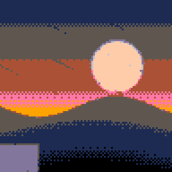

# Gallery

Pictures made with xd-art, each with the recipe that made it, so anyone can make the
same result and learn from the settings.

One folder per entry:

```text
gallery/
  synthetic-sunset/
    recipe.json   the settings (docs/recipes.md)
    result.png    the output, at the scale the recipe asks for
    source.png    the input, when its license allows sharing it (optional)
    README.md     one or two lines: what it is, who made it, the license (optional)
```

`synthetic-sunset` is the landscape from `docs/algorithms.md`
(`cargo run --release -p xd-art-bench --example make_image -- source.png 256 256 scene`)
converted with:

```sh
xd-art-cli convert source.png -o result.png --recipe gallery/synthetic-sunset/recipe.json
```



## Adding yours

Open a pull request with a new folder. Please:

- Only use pictures you made yourself or that are in the public domain (CC0). Say which
  in the folder's README.
- No screenshots of games, no game textures or sprites, no characters you do not own.
- Keep `result.png` under 500 KB; pixel art at its own size or a small scale is usually
  a few kilobytes.
- Include the recipe exactly as saved by the app (export panel, "save recipe") or by
  `--save-recipe`, so the result can be checked.
